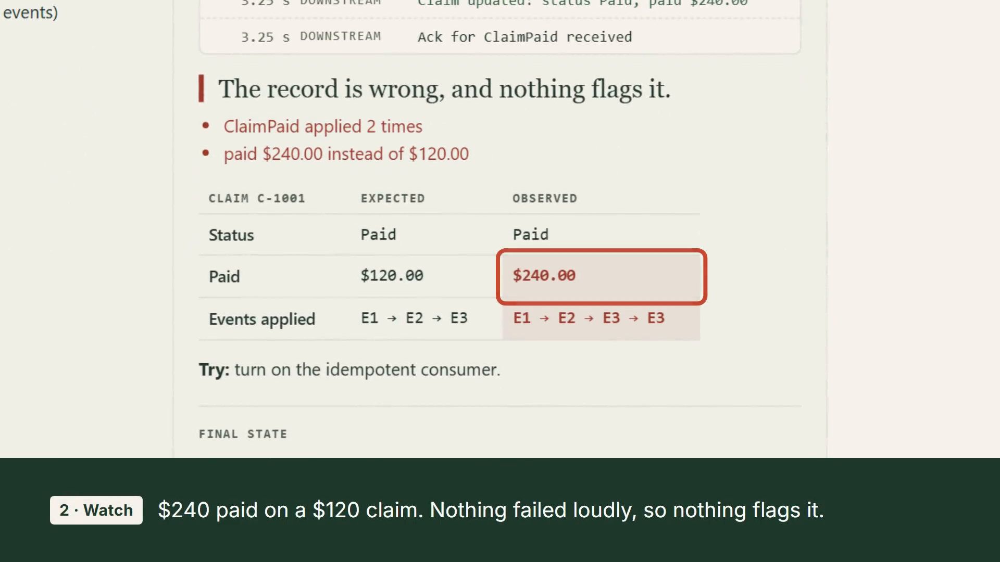

# Integration Failure Lab

Break a small healthcare-style integration on purpose, then watch what happens: traces, retries, queue state, and final outcomes. Flip on deduplication, retry limits, or ordering guarantees and run the same failure again.

Try it on [dflippojr.dev](https://dflippojr.dev/#lab), where it's the site's playground.

[](demo/out/lab-demo.mp4)

*45-second silent demo ([MP4](demo/out/lab-demo.mp4), 1.8 MB): break the claims integration, see the failure, fix it. Captions are burned in. See [Re-rendering the demo](#re-rendering-the-demo).*

**Status:** v1 simulation engine and all twelve scenarios built and tested (`npm test`, Node 20+, no runtime dependencies). Browser UI built (`ui/`): a first-visit picker for **Guided** or **Free-form**, animated trace, expected-vs-observed record, verdict, and final Dead-letter queue, Dropped messages, and Ordering buffer contents. Each final group shows its count and either entry details or an explicit empty state. Trace counters (including Parked / dropped events) are cumulative history, not current queue occupancy: replay can drain the final DLQ while leaving historical parked events counted. Snapshots appear when playback finishes, including with reduced motion, and clear on a new run or mode, scenario, or source switch. **v2 (Java 21 / Spring Boot 4.1.1)** in `java/` executes the same scenario files over real HTTP (a delivery queue with read timeouts, retries, and a dead-letter queue posting to an embedded-Tomcat claim-status service with server-side fault injection) and exports traces to `executed/`. Guided mode on the site can replay those recorded runs next to the simulation.

- [Architecture](docs/ARCHITECTURE.md): components, event model, what's simulated vs. executed
- [Scenarios](docs/SCENARIOS.md): the v1 scenario matrix with expected outcomes
- `engine/engine.js`: pure, deterministic simulator: `run(scenario, overrides) -> { trace, record, dlq, dropped, buffered, stats, verdict }`
- `scenarios/*.json`: the scenarios, shared by the engine and the Java/Spring runner in `java/`

## Develop

```sh
npm ci            # first: installs esbuild (the build minifies dist/) and Playwright
npm test          # engine and UI tests
cd java && ./mvnw verify   # executes all twelve scenarios over real HTTP (Java 21)
java -jar target/integration-failure-lab-0.1.0-SNAPSHOT.jar --lab.export-dir=../executed   # from java/, after verify: re-record traces
npm run build     # from the repo root: assemble minified dist/ (engine, UI, CSS, generated scenarios.js and executed.js)
# the tests fail if dist/ or executed/ drift from their sources, so run npm run build and commit dist/ after changing them
python -m http.server 4180 --directory dist   # open http://127.0.0.1:4180
```

The runner reads scenarios from `../scenarios` relative to where it starts, so run the jar from `java/`.

### Recording drift

**Replay real run** plays `executed/`, so the recordings must be what the current Java runner does, not what an older build did. `npm run recordings` (after `cd java && ./mvnw -B package -DskipTests`) re-records every scenario into a temp directory and compares it with the committed `executed/`. It leaves out `generatedAt`, `warmupMs`, `runtime` (the JDK build) and each trace row's wall-clock `t`, and ignores key order. Any other difference fails the run with a line diff per file: trace order and contents, `record`, `dlq`, `dropped`, `buffered`, the guards and configured timings, `index.json`, or a missing or extra recording. On a failure the temp directory is kept and its path printed. The `recordings` CI job runs it on every push. When a Java change is meant to alter behaviour, re-record from the repository root and commit `executed/` and the rebuilt `dist/`:

```sh
cd java && ./mvnw -B package -DskipTests && java -jar target/integration-failure-lab-0.1.0-SNAPSHOT.jar --lab.export-dir=../executed
cd .. && npm run build
```

The export mode runs the first scenario once and discards it before recording, so a cold JVM cannot reorder the first recording. The runs are real HTTP with 40 ms between emissions, so a heavily loaded machine can still delay one request past the next emission and change the outcome (`applied: ["E2", "E1"]`). The check is meant for an idle machine, such as a GitHub-hosted runner.

### Differential testing

The twelve scenarios only pin down twelve points of what Free-form can reach. `npm run differential` (after `cd java && ./mvnw -B package -DskipTests`) checks the rest: `test/differential/combos.mjs` generates every pair of failure setting (kind, target event and timeout attempts) and single safeguard change, every pair of failures, and a seeded sample of 3-way combinations, including poison and replay after the fix. The script runs each through `engine.run()` and, in one JVM, through the Java runner's batch mode (`--lab.differential-in=<file> --lab.differential-out=<file>`, `DifferentialRunner`, four combinations at a time, each worker with its own store and port) over real loopback HTTP. Java runs the engine's own timing model at a quarter of its speed (`TIME_SCALE` in `scripts/differential.mjs`), because the runner's default timings are not proportional to the engine's and reorder outcomes on their own. Both sides write the same normalised outcome: the record, the DLQ, dropped and buffered event ids, and the verdict (`Verdict.java` ports `judge()`), without timings. Any combination whose outcomes differ fails the run with both outcomes and a repro line (`npm run differential -- --only <id>`). Owner-decided divergences go in `test/differential/known.json`: at most three, each with an issue link and the exact combination ids it explains. A listed combination whose outcomes agree again fails the run as stale, so the file only shrinks. A full run takes about four minutes.

An optional `lab.send-at-ms` override must supply exactly three emission times, one each for E1, E2, and E3 (for example, `--lab.send-at-ms=10,50,90`). Omitting it or supplying an empty list uses `0,40,80`; incomplete lists fail configuration binding before delivery starts.

The website vendors the bundle into `public/lab/` (`node scripts/build.mjs site`, which writes to `../personal-website/public/lab`, so the website checkout must sit next to this repo). The build takes a fixed target name, not a path: `dist` (the default), `site`, or `test` (the git-ignored `dist-test/` the UI tests use); anything else exits with an error. Mount with `mountLab(element, { headingLevel, scenario })`: the scenario title is an `h3` by default, for a lab placed under an `h2`; pass the level that fits your page (2-6). To link to a failure, pass `scenario` as a full ID (`2a-duplicate`) or its chip prefix (`2a`), in any case: the lab opens Guided on that scenario without running it, moving focus or scrolling, and without saving Guided as the visitor's mode (the saved run source still applies). An unknown, empty or non-string value is ignored.

Guided mode loads `executed.js` only when **Replay real run** is activated. Selecting Executed or restoring a saved `ifl-source=exec` preference does not fetch recordings. A small `RECORDING_IDS` manifest in generated `scenarios.js` comes from actual recording keys, so scenarios without recordings remain simulation-only. Pending loads share one import across mounts and disable repeated Run requests; changing mode, scenario, or source discards the old playback request. Successful imports stay cached. Loading and failures appear in the named **Replay status** region; failures offer **Retry replay**, and simulation remains usable.

The build minifies each shipped file on its own with esbuild (pinned in `devDependencies`): no bundling, no source maps, and the same export names, so `executed.js` stays a separate lazy import. The readable sources are `engine/engine.js`, `ui/lab.js` and `ui/lab.css`. Output is byte-identical on Windows and Linux.

The initial static JS graph is now `lab.js ? engine.js, scenarios.js`; `executed.js` is dynamically imported on demand. Generated `scenarios.js` carries only the six fields the browser reads (`id`, `title`, `summary`, `failures`, `safeguards`, `lesson`); the `expect` oracle and the `order` sort key stay in `scenarios/*.json`. Offline sizes measured with #51, #58, #67 and #66 (minification) applied on Windows with Node v24.18.0, unchanged recording fixtures, consistent CRLF line endings for all modules, and each module compressed separately using gzip level 9:

| Initial module | Raw bytes | gzip-9 bytes |
| --- | ---: | ---: |
| lab.js (including loader) | 13,970 | 5,426 |
| engine.js | 5,766 | 2,416 |
| scenarios.js (including manifest) | 4,358 | 1,478 |
| **Total** | **24,094** | **9,320** |

Against issue #26's `5b059c1` baseline (63,161 raw / 12,993 gzip-9), the net reduction is **39,067 raw / 3,673 gzip-9 bytes**, including loader, manifest, and the intervening final-state UI. Against the `9256893` base (64,450 raw / 13,323 gzip-9), the reduction is **40,356 raw / 4,003 gzip-9 bytes**. Minification alone saves 12,425 raw / 2,554 gzip-9 bytes against the unminified #67 graph (36,519 / 11,874). Deferred `executed.js` measures 23,496 raw / 1,726 gzip-9 bytes and `lab.css` 8,645 raw / 2,247 gzip-9 bytes with this normalization. These are offline asset sizes, not production transfer or latency measurements.

To reproduce these figures from the repository root (normalize generated LF and checked-out CRLF consistently):

```sh
node --input-type=module -e 'import {readFileSync} from "node:fs"; import {gzipSync} from "node:zlib"; for (const f of ["lab.js","engine.js","scenarios.js","executed.js","lab.css"]) { const b=Buffer.from(readFileSync("dist/"+f,"utf8").replace(/\r?\n/g,"\r\n")); console.log(f,b.length,gzipSync(b,{level:9}).length); }'
```

The drift tests also traverse the static imports, check that recordings are absent, and verify both normalized totals stay under the minified budget (24,500 raw / 9,500 gzip-9).

All data is synthetic. No real payers, patients, or PHI.

### Re-rendering the demo

The clip is rendered with [HyperFrames](https://github.com/heygen-com/hyperframes) (Apache-2.0). After a UI change, run `npm run demo:render` from the repository root (Node 22+, after `npm ci` and `npx playwright install chromium`), check the new clip, and commit `demo/out/`. The command:

1. builds the current `engine/`, `ui/` and `scenarios/` into the git-ignored `dist-test/` and drives the real lab with Playwright (`demo/capture.mjs`): Free-form, **Ack lost for** ClaimPaid, **Run**, then **Idempotent consumer** and **Run** again. Captures go to the git-ignored `demo/scenes/captures/`, and the script stops if the lab no longer pays $240.00 and then $120.00.
2. renders the committed scenes in `demo/scenes/index.html` (camera moves, highlights and captions over those captures) to `demo/out/lab-demo.mp4` (H.264, 1920x1080, 30 fps, 45 s) and takes `demo/out/lab-demo-poster.png` from 22 s. It fails if the clip is over 5 MB.

HyperFrames, FFmpeg (`ffmpeg-static`) and GSAP are pinned in `demo/package.json` with their own lockfile, and the first run installs them into `demo/node_modules/`. They are not part of the root install, CI or `dist/`. HyperFrames downloads its own headless Chrome (about 270 MB) into `~/.cache/hyperframes` on first use. Renders use two workers and software GL. With the same machine and inputs, they are byte-identical. Another OS or font set can differ by a few pixels. To change the story or captions, edit `demo/scenes/index.html` and `demo/capture.mjs`. To check the composition, run `node demo/node_modules/hyperframes/bin/hyperframes.mjs check demo/scenes` after a render.

### Disposable UI testing

See [the UI testing contract](docs/ui-testing.md) for isolated startup, synthetic journeys, device coverage and cleanup. Run `npm ci`, then `npx playwright install chromium`, and `npm run test:ui -- --workers=1`. The test runner owns its loopback server; finish with `npm run ui:stop`, including after failures. For manual exploration use `npm run ui:start` and the printed local URL. No backend or credentials are required.

### CI

Run the whole gate locally with `npm run ci:local` (see [AGENTS.md](AGENTS.md)).

GitHub Actions runs two workflows on pushes and pull requests, and a third on pull requests only:

- `.github/workflows/ci.yml`: five jobs and a `gate` job, which is the one check to require.
  - `engine`: `npm run test:coverage` (Node 22), which is `npm test` with line and branch coverage floors.
  - `java`: `./mvnw -B verify` in `java/` (Java 21), including a JaCoCo line-coverage floor.
  - `differential`: `npm run differential` against a freshly built runner jar (see [Differential testing](#differential-testing)).
  - `recordings`: `npm run recordings` against a freshly built runner jar (see [Recording drift](#recording-drift)).
  - `playwright`: isolated desktop/Pixel 7 Playwright journeys in light, a host-token and Guided/Free-form smoke test on both dark projects, plus desktop-light breakpoint and live-resize checks on GitHub-hosted runners with one worker.
  - `gate`: runs after the other five even when one fails, and passes only when all five succeed.
- `.github/workflows/sonar.yml`: SonarCloud analysis with coverage (lcov from the Node test runner, JaCoCo from the Java module). It runs on pushes to `main` and on pull requests from this repo, and fails when the quality gate fails. A newer push cancels a PR's running analysis, but runs on `main` are never cancelled. Project keys are in `sonar-project.properties`.
- `.github/workflows/gate-guard-target.yml`: the shared gate guard from dflippojr/.github, pinned by full commit SHA. It posts the `gate-guard` check, which fails a pull request that deletes or skips tests, adds or raises retries, or edits workflows, coverage floors or Sonar config, unless the owner's `gate-change-approved` label was applied after the newest push. It runs under `pull_request_target`, so GitHub reads it from `main` and a pull request can't rewrite the check that judges it; it reads the pull request's diff as data and never checks out or runs its code. The `main` ruleset requires `gate-guard` next to `gate`, both from GitHub Actions.

Dependabot checks weekly for Maven updates in `/java`, npm updates at `/`, and GitHub Actions updates at `/`, as configured in `.github/dependabot.yml`. The root npm entry covers the Playwright test dependency.

SonarCloud requires an authorized analysis token named `SONAR_TOKEN` in repository **Actions** secrets for ordinary runs and separately in **Dependabot** secrets for Dependabot PRs (Settings → Secrets and variables → Dependabot → New repository secret). GitHub supplies the appropriate secret store through the same workflow reference; Actions secrets are unavailable to Dependabot-triggered runs. Fork PRs remain excluded. If the token is absent, the SonarCloud workflow emits a notice and a job summary and skips analysis cleanly; this is not a successful analysis or a passing quality gate. The `ci` workflow still runs.

Owner verification: ensure the configured SonarCloud project exists with automatic analysis disabled, save the authorized Dependabot `SONAR_TOKEN`, and verify analysis on a `main` push, an ordinary same-repository PR, and at least one real Dependabot PR. Record the workflow and SonarCloud result links for the PR's head commit in issue #16; a missing-token notice does not satisfy that verification.

## License

MIT. See [LICENSE](LICENSE).
